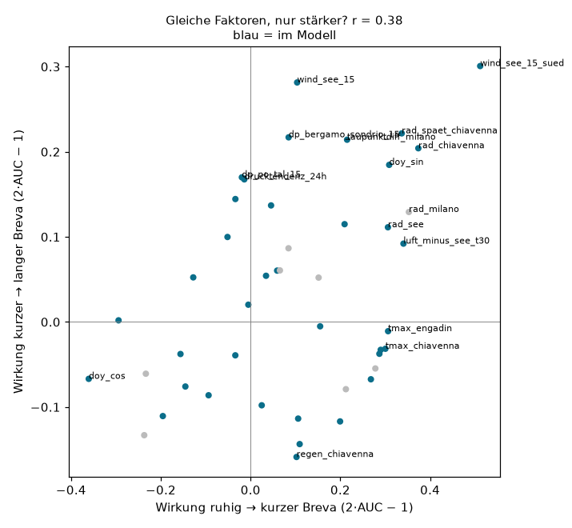

# Kein Breva, Grenzfall, kurzer und langer Breva

März–Oktober 2014–2026. Tage je Klasse und Jahr:

```
kl
ruhig        75.8
grenzfall    77.2
kurz         40.7
lang         46.5
```

Wind auf dem See (Schätzung aus Samolaco/Colico, stärkste Stunde 11–20 Uhr) und Ende des Breva:

```
           see_max_stunde  breva_h  breva_start  breva_ende
kl                                                         
ruhig                 5.7      0.0          NaN         NaN
grenzfall            13.3      0.0         16.0        16.0
kurz                 17.2      3.0         15.0        18.0
lang                 20.1      6.0         14.0        20.0
```

## 1. Satellit um 19:15 je Klasse (Rauigkeit über ruhig, dB; nur Abende mit Südrichtung)

```
           nord  mitte  sued  anstieg  rau_nord  abende  anteil_nord_ab_4dB
kl                                                                         
ruhig      1.00   0.76  1.46    -0.89      0.02      55                0.05
grenzfall  3.42   2.22  1.31     1.64      0.34      76                0.30
kurz       3.44   2.05  1.32     1.99      0.35      49                0.33
lang       4.48   3.02  2.21     2.28      0.63      70                0.73
```

Widersprüche: kurz, aber Nordbecken ≥ 4 dB um 19:15: 16 von 49; lang, aber < 3 dB: 8 von 70; ruhig, aber ≥ 4 dB: 3 von 55.
Ein kurzer Breva, der um 19:15 noch rau ist, ist entweder spät gekommen oder an den Stationen unterschätzt; ein langer, der glatt ist, war vor 19 Uhr vorbei.


## 2. Mehr Breva-Faktoren oder eigene Faktoren?

AUC > 0,5: Größe ist in der zweiten Klasse höher; < 0,5: tiefer; 0,5: kein Unterschied.

- Korrelation der Wirkungen (ruhig→kurz gegen kurz→lang) über alle 45 Größen: **0.38**
- Von den 20 Größen, die Breva deutlich von ruhig trennen, zeigen 60 % von kurz nach lang in dieselbe Richtung.
- Größen, die nur lang von kurz trennen (eigene Faktoren): dp_po_tal_15, dp_bergamo_sondrio_15, drucktendenz_24h

Stärkste Trenner ruhig → kurz:
```
            groesse  im_modell  ruhig_kurz  kurz_lang  median_ruhig  median_grenzfall  median_kurz  median_lang
   wind_see_15_sued       True        0.76       0.65          0.96              1.99         2.45         3.00
      rad_chiavenna       True        0.69       0.60          3.52              4.24         4.65         4.98
            doy_cos       True        0.32       0.47         -0.24             -0.46        -0.71        -0.73
         rad_milano      False        0.68       0.56          3.84              4.51         5.08         5.32
 luft_minus_see_t30       True        0.67       0.55          2.76              4.34         5.08         5.74
rad_spaet_chiavenna       True        0.67       0.61          1.00              1.26         1.39         1.52
            doy_sin       True        0.65       0.59         -0.76              0.06         0.08         0.46
       tmax_engadin       True        0.65       0.49         10.00             11.60        14.10        14.50
            rad_see       True        0.65       0.56          3.58              4.28         4.63         4.90
     tmax_chiavenna       True        0.65       0.48         21.00             22.40        24.70        24.50
        geo_staerke       True        0.35       0.50          1.35              1.07         0.87         0.88
        tmax_milano       True        0.64       0.48         22.40             23.90        26.50        26.20
       tmax_sondrio       True        0.64       0.48         21.20             22.60        24.70        24.60
           tmax_see      False        0.64       0.47         21.70             23.00        25.30        25.00
       tmax_bergamo       True        0.63       0.47         21.20             22.30        24.70        24.10
```
Stärkste Trenner kurz → lang:
```
              groesse  im_modell  ruhig_kurz  kurz_lang  median_ruhig  median_grenzfall  median_kurz  median_lang
     wind_see_15_sued       True        0.76       0.65          0.96              1.99         2.45         3.00
          wind_see_15       True        0.55       0.64          2.40              2.50         2.70         3.20
  rad_spaet_chiavenna       True        0.67       0.61          1.00              1.26         1.39         1.52
dp_bergamo_sondrio_15       True        0.54       0.61         -1.30             -1.10        -1.20        -0.60
  taupunktdiff_milano       True        0.61       0.61          8.70              9.70        10.80        12.40
        rad_chiavenna       True        0.69       0.60          3.52              4.24         4.65         4.98
              doy_sin       True        0.65       0.59         -0.76              0.06         0.08         0.46
         dp_po_tal_15       True        0.49       0.58         -1.80             -1.70        -2.00        -1.40
     drucktendenz_24h       True        0.49       0.58         -0.20             -0.30        -0.20         0.60
      regen_chiavenna       True        0.55       0.42          0.20              0.30         0.80         0.20
         dp_po_tal_18       True        0.48       0.57         -2.30             -2.30        -2.70        -2.20
            regen_see       True        0.55       0.43          0.10              0.30         0.50         0.20
   dp_tag_minus_nacht       True        0.52       0.57          0.40              0.50         0.50         0.70
  bodenfeuchte_milano      False        0.38       0.43          0.36              0.35         0.32         0.30
           rad_milano      False        0.68       0.56          3.84              4.51         5.08         5.32
```



## 3. Trainingsvarianten (7-Tage-Modell, echte Läufe 2024–heute, März–Oktober)

auc_breva: Breva-Tag ja/nein; auc_lang: langer Breva gegen alle anderen Tage; auc_lang_unter_breva: nur unter den Breva-Tagen – erkennt die Variante, ob er lang wird? delta_breva/bereich_90: gegen V0, Bootstrap über Wochen (schließt der Bereich 0 aus, ist der Unterschied belastbar).

```
 vorlauf                     variante  tage  auc_breva  auc_lang  auc_lang_unter_breva  delta_breva      bereich_90
       1          V0 ja/nein (bisher)   678      0.840     0.853                 0.711          NaN             NaN
       1  V1 ohne Grenzfälle als nein   678      0.827     0.849                 0.703       -0.013 -0.025 … -0.001
       1 V2 Grenzfälle halb gewichtet   678      0.844     0.860                 0.713        0.004 -0.003 … +0.010
       1              V3 Stufen 0/1/2   678      0.833     0.842                 0.693       -0.007 -0.018 … +0.005
       1           V4 Stunden ≥ 14 kn   678      0.832     0.851                 0.697       -0.008 -0.019 … +0.004
       1           nur lang (ja/nein)   678      0.829     0.839                 0.678       -0.011 -0.027 … +0.005
       2          V0 ja/nein (bisher)   678      0.819     0.833                 0.701          NaN             NaN
       2  V1 ohne Grenzfälle als nein   678      0.804     0.822                 0.682       -0.015 -0.029 … -0.002
       2 V2 Grenzfälle halb gewichtet   678      0.821     0.840                 0.702        0.002 -0.005 … +0.009
       2              V3 Stufen 0/1/2   678      0.809     0.821                 0.686       -0.010 -0.024 … +0.002
       2           V4 Stunden ≥ 14 kn   678      0.810     0.833                 0.703       -0.009 -0.023 … +0.004
       2           nur lang (ja/nein)   678      0.810     0.825                 0.684       -0.009 -0.029 … +0.010
       3          V0 ja/nein (bisher)   678      0.816     0.836                 0.703          NaN             NaN
       3  V1 ohne Grenzfälle als nein   678      0.792     0.820                 0.691       -0.024 -0.039 … -0.009
       3 V2 Grenzfälle halb gewichtet   678      0.814     0.839                 0.707       -0.002 -0.009 … +0.005
       3              V3 Stufen 0/1/2   678      0.809     0.833                 0.698       -0.007 -0.020 … +0.006
       3           V4 Stunden ≥ 14 kn   678      0.810     0.836                 0.701       -0.006 -0.021 … +0.008
       3           nur lang (ja/nein)   678      0.806     0.835                 0.699       -0.010 -0.030 … +0.008
```
