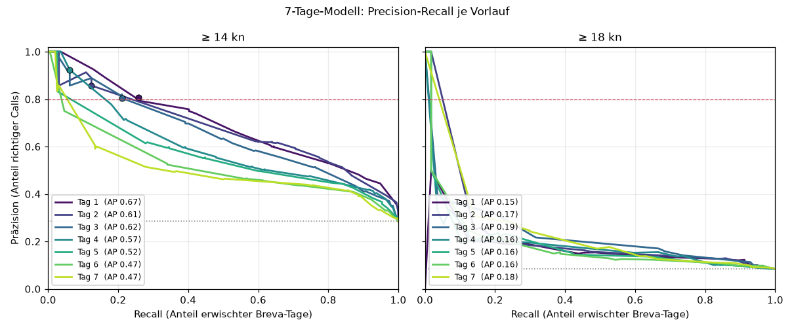
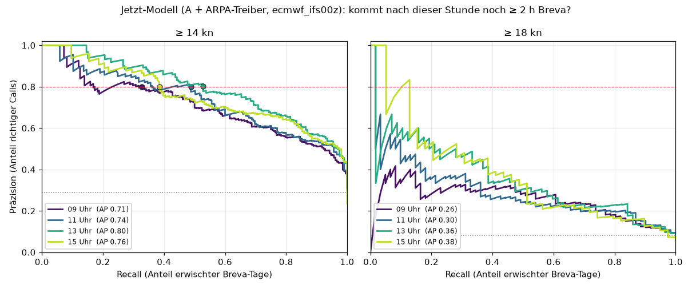

# Precision-Recall

Out-of-fold-Vorhersagen 2024–heute mit echten Läufen. AP = Average Precision (Fläche unter der Kurve). Tabelle: größter Recall, bei dem die Präzision mindestens 60/70/80 % ist, und ab welcher (geeichten) Chance.
Nur März–Oktober.

## 7-Tage-Modell



```
praezision_ziel                0.6    0.7    0.8
schwelle wann  ap    anteil                     
14       Tag 1 0.666 0.286   0.644  0.423  0.258
         Tag 2 0.612 0.286   0.655  0.124  0.124
         Tag 3 0.622 0.286   0.526  0.392  0.211
         Tag 4 0.565 0.286   0.227  0.227  0.062
         Tag 5 0.519 0.286   0.284    NaN    NaN
         Tag 6 0.470 0.286   0.046  0.046    NaN
         Tag 7 0.475 0.286   0.139    NaN    NaN
```

## Jetzt-Modell (A + ARPA-Treiber, Lauf ecmwf_ifs00z)



Ungeeichte Modellausgabe; „ab_chance“ in pr_kurven.csv ist daher die Rohschwelle.

```
praezision_ziel                 0.6    0.7    0.8
schwelle wann   ap    anteil                     
14       09 Uhr 0.708 0.313   0.750  0.505  0.327
         11 Uhr 0.737 0.309   0.771  0.566  0.488
         13 Uhr 0.795 0.300   0.864  0.709  0.528
         15 Uhr 0.758 0.235   0.846  0.603  0.385
18       13 Uhr 0.355 0.086   0.158    NaN    NaN
         15 Uhr 0.376 0.059   0.154    NaN    NaN
```

