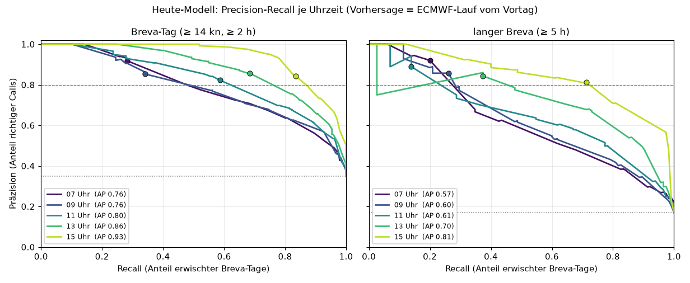

# Precision-Recall

Out-of-fold-Vorhersagen 2024–heute mit echten Läufen. AP = Average Precision (Fläche unter der Kurve). Tabelle: größter Recall, bei dem die Präzision mindestens 60/70/80 % ist, und ab welcher (geeichten) Chance.
Nur März–Oktober.

## 7-Tage-Modell


```
praezision_ziel                0.6    0.7    0.8
schwelle wann  ap    anteil                     
14       Tag 1 0.728 0.35    0.827  0.553  0.350
         Tag 2 0.689 0.35    0.785  0.456  0.181
         Tag 3 0.695 0.35    0.734  0.523  0.156
         Tag 4 0.638 0.35    0.544  0.376  0.068
         Tag 5 0.602 0.35    0.489  0.245    NaN
         Tag 6 0.566 0.35    0.481    NaN    NaN
         Tag 7 0.572 0.35    0.397  0.249    NaN
```

## Heute-Modell



```
praezision_ziel                 0.6    0.7    0.8
schwelle wann   ap    anteil                     
14       07 Uhr 0.762 0.35    0.806  0.684  0.283
         09 Uhr 0.759 0.35    0.831  0.667  0.342
         11 Uhr 0.799 0.35    0.895  0.586  0.586
         13 Uhr 0.864 0.35    0.945  0.852  0.684
         15 Uhr 0.933 0.35    0.970  0.928  0.835
lang     07 Uhr 0.574 0.17    0.435  0.200  0.200
         09 Uhr 0.597 0.17    0.487  0.296  0.261
         11 Uhr 0.614 0.17    0.626  0.365  0.139
         13 Uhr 0.702 0.17    0.730  0.643  0.374
         15 Uhr 0.808 0.17    0.809  0.809  0.713
```

