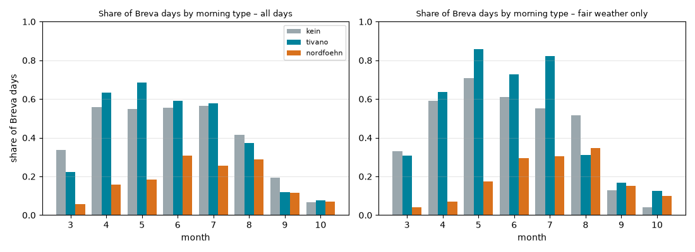

# Tivano und Breva

Tivano = Colico Nordwind 6–10 Uhr mind. 2 h ≥ 2 kn, ohne Föhnlage (Zürich − Mailand < 4.0 hPa) und ohne Nordwind am Nachmittag. März–Oktober 2014–2026, 2923 Tage.

## 1. Breva nach der Art des Morgens

```
           tage  breva  breva_roh  von_regel_gestrichen  lang  stunden  see_max  nachm_nord
morgen                                                                                     
kein       2287   0.39       0.40                  0.01  0.21     2.06    14.15        0.07
nordfoehn   388   0.19       0.23                  0.04  0.11     1.09     9.66        0.57
tivano      248   0.48       0.48                  0.01  0.25     2.44    15.36        0.03
```
breva_roh: Breva am Nachmittag ohne Morgen-/Nordwindregel; von_regel_gestrichen: Anteil Tage, die nur wegen dieser Regeln nicht als Breva-Tag zählen; nachm_nord: Nordwind auch am Nachmittag.

Breva-Anteil je Monat:

```
morgen  kein  nordfoehn  tivano  tage_tivano
time                                        
3       0.34       0.06    0.22           27
4       0.56       0.16    0.63           30
5       0.55       0.18    0.69           35
6       0.55       0.31    0.59           39
7       0.56       0.25    0.58           52
8       0.42       0.29    0.37           35
9       0.19       0.12    0.12           17
10      0.07       0.07    0.08           13
```

## 2. Nur Schönwetter (Sonne im Tal über dem Monatsmedian, kein Regen)

```
           tage  breva  breva_roh  lang  stunden
morgen                                          
kein        818   0.39       0.40  0.22     2.15
nordfoehn   243   0.19       0.26  0.12     1.21
tivano      107   0.55       0.57  0.35     3.12
```

## 3. Bringt der Tivano etwas über das Wetter hinaus?

Breva-Chance aus dem Wetter (ERA5, je Jahr out-of-fold) in Zehnteln; je Zehntel der tatsächliche Breva-Anteil nach der Art des Morgens (mean) und die Zahl der Tage (size):

```
        p_mittel  mean                  size                 
morgen            kein nordfoehn tivano kein nordfoehn tivano
zehntel                                                      
0           0.01  0.01      0.01   0.00  166       123      4
1           0.05  0.04      0.00   0.00  232        54      6
2           0.10  0.12      0.16   0.05  233        38     21
3           0.16  0.22      0.21   0.00  238        34     20
4           0.24  0.23      0.36   0.17  230        39     24
5           0.36  0.33      0.37   0.56  233        27     32
6           0.49  0.52      0.28   0.51  232        25     35
7           0.62  0.57      0.58   0.70  229        26     37
8           0.74  0.78      0.70   0.63  245        20     27
9           0.87  0.91      0.50   0.81  249         2     42
```

Modell nur Wetter: AUC 0.857; mit gemessenem Tivano am Morgen: 0.859 (Unterschied +0.002, 90 % Bereich -0.000 … +0.004; März–Oktober, 2923 Tage).
Ist der Unterschied belastbar, gehört der Tivano ins Heute-Modell (ab 9/11 Uhr gemessen); das 7-Tage-Modell kann ihn nur über eine Tivano-Vorhersage nutzen.

## 4. Satellit am Morgen → Breva am Nachmittag (oberer See)

```
                bilder  breva  lang  stunden
klasse                                      
nordwind           137   0.25  0.10     1.15
nordwind_stark      16   0.19  0.19     1.00
ruhig              291   0.42  0.24     2.10
sonst              266   0.33  0.18     1.76
sued                22   0.41  0.27     2.50
```


